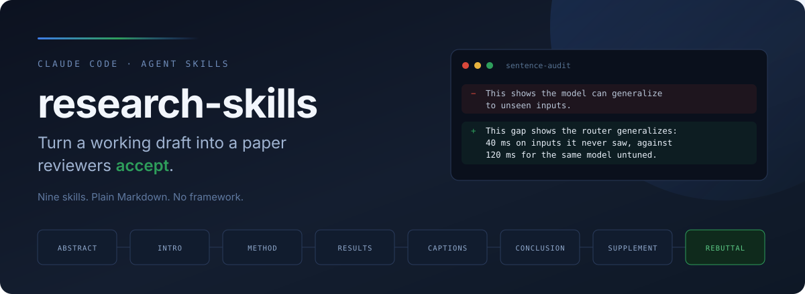
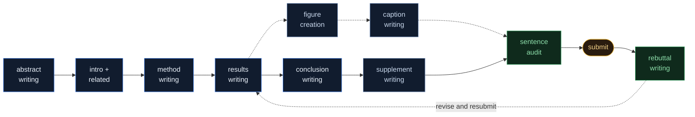

<div align="center">



<br/>

[](#-the-skills)
[](#-quick-start)
[](#-why-its-plain-markdown)
[](LICENSE)
[](https://github.com/Alexyskoutnev/research-skills/stargazers)

**Ten Claude Code skills for writing an ML paper, abstract to rebuttal.**
Not prompts. Recipes, axioms, and mechanical checklists, reverse-engineered from papers that got in.
</div>

---

> Most writing advice tells you to *be clear*. That is not actionable at 2 a.m. three days before the deadline.
> These skills tell you: contribution in sentence one, strongest verb available, every number paired with
> its comparison, zero instances of "can", no bare "This". Rules a machine can check, because a machine checks them.
## Contents

- [What this is](#-what-this-is)
- [Quick start](#-quick-start)
- [The skills](#-the-skills)
- [How they chain](#-how-they-chain)
- [What "good" looks like](#-what-good-looks-like)
- [Where the rules come from](#-where-the-rules-come-from)
- [Why it's plain Markdown](#-why-its-plain-markdown)
- [Conventions](#-conventions)
- [Contributing](#-contributing)
- [License](#-license)

## 🎯 What this is

A paper section fails for boring, findable reasons. The abstract buries the contribution in sentence four.
A number appears with nothing to compare it against. A caption says "Results on the benchmark" instead of
stating what the figure proves. Every reviewer notices. Nobody tells you which one it was.
Each skill in this repo is one section of a paper, decomposed into:
- **a recipe**: the shape that section takes, with the fill-in-the-blank template
- **axioms**: the judgment calls, and how strong authors resolve them
- **a mechanical checklist**: the pass a machine runs before you ship

Point Claude Code at a draft, invoke the skill, and it applies the same pass every time. No taste required
at 2 a.m. The taste is already in the file.
## 🚀 Quick start

```bash
# 1. Clone
git clone https://github.com/Alexyskoutnev/research-skills.git

# 2. Install: copy the skills you want into your skills directory
mkdir -p ~/.claude/skills
cp -r research-skills/abstract-writing ~/.claude/skills/
cp -r research-skills/sentence-audit  ~/.claude/skills/

# or take all ten, personally:
cp -r research-skills/*-writing research-skills/sentence-audit \
      research-skills/figure-creation ~/.claude/skills/

# or scope them to one project instead:
cp -r research-skills/*-writing research-skills/sentence-audit \
      research-skills/figure-creation <your-project>/.claude/skills/
```

Then in Claude Code:
```
> /abstract-writing            revise my abstract for submission
> /results-writing             the results section reads like a list, fix the claims
> /caption-writing             Figure 3's caption states nothing, make it land
> /sentence-audit              precision pass on the paragraph I just rewrote
> /rebuttal-writing            reviews are in, triage them before I draft anything
```

Skills also load automatically when a request matches their description, so `"tighten this abstract"`
pulls in `abstract-writing` without you naming it.
<details>
<summary><b>Using another agent (Codex CLI, Cursor, or your own)</b></summary>

<br/>

Every skill is a single `SKILL.md` in plain Markdown with YAML frontmatter. Nothing in it is
Claude-specific. Point any agent at the file and tell it to follow the file:
```
Read ~/research-skills/method-writing/SKILL.md and apply it to section 3 of paper.tex.
```

The reference guides beside each `SKILL.md` (`method-guide.md`, etc.) hold the long-form method
if the agent wants more than the operating summary.
</details>

## 📚 The skills

| Skill | What it does | Reach for it when |
|---|---|---|
| **abstract-writing** | Three master recipes, the six-questions structure, sentence-surgery checks | The abstract is a summary instead of an argument |
| **intro-related-writing** | Seven-question funnel, contributions-first, credit-then-contrast for rivals | Your related work reads like an annotated bibliography |
| **method-writing** | N-named-parts skeleton, star-component discipline, algorithm-box and figure devices | The method is complete but nobody can reimplement it |
| **results-writing** | Claim-headed paragraphs, lesion ablations, measurement over scoreboard | Results list numbers rather than discharging claims |
| **figure-creation** | One-job rule, form heuristic, Figma and matplotlib tracks, column width, color accessibility | The figure is decoration, or it turns to mush in print |
| **caption-writing** | Name → decode → land, flagship-vs-workhorse split, figure-text exactness | A skimming reviewer gets nothing from your figures |
| **conclusion-writing** | Envoi shape, reprise-not-report, flip-the-shortfall, refutable-vista close | The conclusion restates the abstract and stops |
| **supplement-writing** | Evidence-locker rule, verbatim exhibits, prose-first exhibits-last order | The appendix is a junk drawer, not an audit trail |
| **sentence-audit** | Twelve-defect list, minimal rewrites, aggressive condensing, LaTeX invariants | A paragraph reads wrong and you cannot name why |
| **rebuttal-writing** | Viability gate, P0–P3 concern triage, Direct Answer → Evidence → Revision | Reviews landed and panic is not a strategy |

<details>
<summary><b>What's inside a skill folder</b></summary>

<br/>

```
method-writing/
├── SKILL.md          # frontmatter (name, description) + the operating summary
└── method-guide.md   # the full plain-English method: recipes, templates, checklists
```

`SKILL.md` is what the agent loads first: short, procedural, ~40 lines. The guide beside it is
the long form: worked recipes, fill-in templates, the "never do this in a method section" lists,
and the reasoning behind each rule so you can overrule it deliberately.
</details>

## 🤖 The linter

Most of the rules in this repo are mechanical, which means a script can check them. `scripts/audit.py`
runs the checkable ones over a `.tex` or `.md` file. No dependencies, standard library only.

```bash
python3 scripts/audit.py paper.tex
python3 scripts/audit.py --rules                    # every rule, and which skill it comes from
python3 scripts/audit.py paper.tex --only bare-this
python3 scripts/audit.py paper.tex --quiet          # exit code only, for a pre-commit hook
```

```
paper.tex:118  [bare-this]
    This
    bare demonstrative: name the noun it points at
paper.tex:118  [lonely-number]
    93.3
    lonely number: pair it with what it beats
```

It strips math, figures, listings, and comments before reading, so it audits prose rather than
markup. It flags bare demonstratives, hedges, lonely numbers, agentless passives, dead nouns,
captions that announce themselves, vague future work, and sentences that outran their point.

It exits 1 when anything is flagged. The remaining rules in the guides are judgment calls, and
those are what the agent is for.

## 🔗 How they chain

Use one, or run the lifecycle end to end. Each skill assumes the previous section exists but
never requires it.


The one ordering that matters: **write the contribution bullets before the introduction**, and
**write the abstract last or twice**. Everything else composes in any order.
## ✨ What "good" looks like

Every rule below is mechanical. The skill checks it, no taste needed. Examples use a toy system
so the rule is what you notice.
<table>
<tr><th width="50%">❌ Before</th><th width="50%">✅ After</th></tr>

<tr><td>

*"In this paper, we study the problem of request scheduling and show that our approach can improve latency."*

</td><td>

*"We present ROUTER, a scheduler that cuts tail latency from 120 ms to 40 ms under peak load."*

</td></tr>
<tr><td colspan="2"><sub><b>abstract-writing</b>: contribution in sentence one, strong verb, no "can", numbers travel in pairs.</sub></td></tr>

<tr><td>

*"This shows the model generalizes."*

</td><td>

*"This gap shows the model generalizes."*

</td></tr>
<tr><td colspan="2"><sub><b>sentence-audit</b>: never a bare This/These. The reader should not have to guess the antecedent.</sub></td></tr>

<tr><td>

*"Figure 3: Results on the benchmark."*

</td><td>

*"Figure 3: Latency under load. Each dot is one run, both axes logarithmic. ROUTER stays under 40 ms at every load where the baseline exceeds 120 ms."*

</td></tr>
<tr><td colspan="2"><sub><b>caption-writing</b>: name it, decode it, land the claim. A skimmer reads captions and nothing else.</sub></td></tr>

<tr><td>

*"We also ran an ablation where we removed the scheduler."*

</td><td>

*"**Removing the scheduler costs more than removing the cache.** Deleting the scheduler drops throughput 31%, against 4% for the cache..."*

</td></tr>
<tr><td colspan="2"><sub><b>results-writing</b>: every findings paragraph opens with the claim it discharges, in bold, and the numbers land in the first two sentences.</sub></td></tr>

<tr><td>

*"Prior work also uses learned schedulers [12, 19]. Unlike them, our method is better."*

</td><td>

*"FASTQUEUE introduced learned admission control [12], and we keep its admission model unchanged. The difference is where the decision lands: FASTQUEUE ranks requests already queued, whereas ROUTER decides before the queue exists, so a mispredicted request costs nothing to evict."*

</td></tr>
<tr><td colspan="2"><sub><b>intro-related-writing</b>: credit warmly, contrast once, state the consequence. Your closest rival is your likeliest reviewer.</sub></td></tr>

</table>

## 🔬 Where the rules come from

These are not invented style preferences. Each skill was built in two passes:
**1. Forensic dissection.** Accepted papers from leading ML groups, read line by line, not for
content but for construction. Where does the contribution sentence sit? How many words before the
first number? What does the last sentence of the conclusion do? Patterns that held across authors
became rules. Patterns where strong authors *disagreed* became documented judgment calls, with
both options and the trade-off.
**2. A real submission cycle.** Every skill was then used to build an actual paper, drafted,
torn apart in faculty review, rewritten, torn apart again. Rules that survived contact with real
reviewers stayed. Rules that produced stilted prose were cut. The checklists are the residue of
what actually got flagged.
That is why the rules are oddly specific. "Numbers travel in pairs" is in there because a lone
number drew a comment. "No bare This" is in there because an advisor circled one.
## 🪶 Why it's plain Markdown

No framework. No dependencies. No database, daemon, or config to maintain. Ten folders, each with a
`SKILL.md` any LLM can read, plus one script that checks the mechanical rules for you.
Fork it and overrule the parts you disagree with. The guides explain the reasoning behind each rule
precisely so you can. A house style you cannot argue with is not a house style, it is a cage.
## 📐 Conventions

- One skill per folder. `SKILL.md` carries the frontmatter (`name` matching the folder, `description`
  stating what it does *and when to use it*) plus a short operating summary.
- Long-form material lives in reference `.md` files beside `SKILL.md`, never inside it. The operating
  summary should fit in a glance.
- Skills stay transferable: no project data, no private paths, no numbers from unpublished work.
  Examples use toy systems.
- Improve a skill inside a project, then port the improvement back here.
## 🤝 Contributing

PRs welcome, especially for sections not covered yet: a *limitations* skill, a *cover-letter* skill,
a domain-specific variant for theory or systems papers.
Add `your-skill/SKILL.md` with valid frontmatter, keep the examples generic, and open a PR.
If your skill encodes a rule, say where the rule came from.
## 📄 License

MIT. See [LICENSE](LICENSE).

---

<div align="center">
<sub>If a rule here saves you a round of reviews, star it.</sub>
</div>
